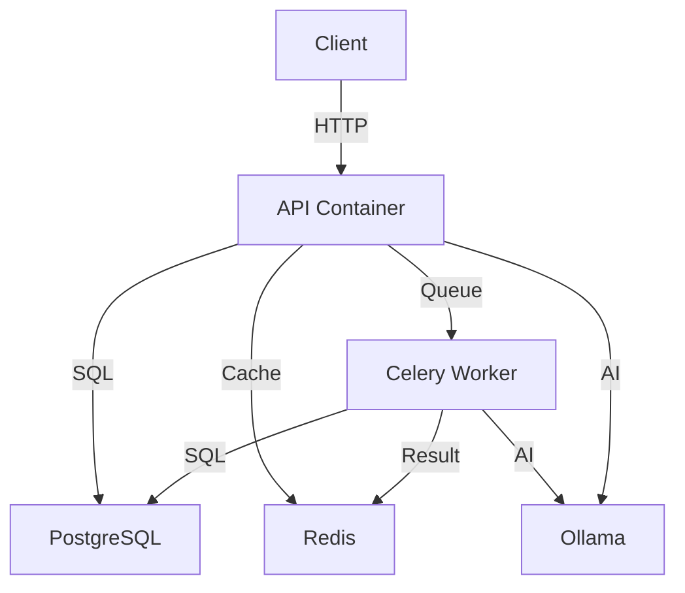

# Docker Setup Guide - Sanad AEO Auditor

Quick guide to run the Sanad AEO Auditor using Docker.

## Prerequisites

- Docker Desktop or Docker Engine (20.10+)
- Docker Compose (v2.0+)
- At least 4GB of free RAM
- 10GB of free disk space

## Quick Start

### 1. Initial Setup

```bash
# Copy environment file
cp .env.example .env

# Edit .env and update any necessary values
# For production, MUST change:
# - SECRET_KEY
# - POSTGRES_PASSWORD
# - Database credentials
```

### 2. Start All Services

```bash
# Start in detached mode
docker-compose up -d

# Or build and start
docker-compose up -d --build
```

### 3. Pull Ollama Model

The AI model needs to be downloaded on first run:

```bash
# Pull the model (this may take several minutes)
docker-compose exec ollama ollama pull qwen2.5:7b

# Verify model is downloaded
docker-compose exec ollama ollama list
```

### 4. Verify Services

```bash
# Check all services are running
docker-compose ps

# View logs
docker-compose logs -f api

# Check API health
curl http://localhost:8000/health
```

### 5. Access the Application

- **API**: http://localhost:8000
- **API Docs**: http://localhost:8000/docs
- **pgAdmin** (optional): http://localhost:5050
- **Flower** (optional): http://localhost:5555

## Service Management

### Start/Stop Services

```bash
# Start all services
docker-compose up -d

# Stop all services
docker-compose stop

# Stop and remove containers
docker-compose down

# Stop and remove containers + volumes (⚠️ deletes data!)
docker-compose down -v
```

### View Logs

```bash
# All services
docker-compose logs -f

# Specific service
docker-compose logs -f api
docker-compose logs -f celery-worker

# Last 100 lines
docker-compose logs --tail=100 api
```

### Restart Services

```bash
# Restart all
docker-compose restart

# Restart specific service
docker-compose restart api
```

## Development Mode

For development with hot reload and additional tools:

```bash
# Set development mode in .env
BUILD_TARGET=development
VOLUME_MODE=rw
UVICORN_RELOAD=--reload

# Start with development tools
docker-compose --profile with-monitoring up -d

# This includes:
# - Flower for Celery monitoring
# - Hot reload for API changes
```

## Database Management

### Run Migrations

Migrations run automatically on startup, but you can run manually:

```bash
# Run migrations
docker-compose exec api alembic upgrade head

# Create new migration
docker-compose exec api alembic revision --autogenerate -m "description"

# Rollback one migration
docker-compose exec api alembic downgrade -1

# Check current version
docker-compose exec api alembic current
```

### Access Database

```bash
# Via PostgreSQL client
docker-compose exec postgres psql -U sanad_user -d sanad_db

# Or use pgAdmin (if enabled)
# Navigate to http://localhost:5050
```

## Optional Services

### Enable pgAdmin

```bash
docker-compose --profile with-pgadmin up -d pgadmin
```

Access: http://localhost:5050
- Email: admin@sanad.local (or from .env)
- Password: admin (or from .env)

### Enable Flower (Celery Monitoring)

```bash
docker-compose --profile with-monitoring up -d flower
```

Access: http://localhost:5555

### Enable Celery Beat (Periodic Tasks)

```bash
docker-compose --profile with-scheduler up -d celery-beat
```

## Troubleshooting

### Services won't start

```bash
# Check logs
docker-compose logs

# Check specific service
docker-compose logs postgres
docker-compose logs redis

# Verify health
docker-compose ps
```

### Database connection errors

```bash
# Check PostgreSQL is healthy
docker-compose exec postgres pg_isready -U sanad_user

# Verify connection from API
docker-compose exec api python -c "
from app.database import engine
try:
    with engine.connect() as conn:
        print('✅ Database connection successful')
except Exception as e:
    print(f'❌ Database error: {e}')
"
```

### Ollama model not found

```bash
# Pull the model
docker-compose exec ollama ollama pull qwen2.5:7b

# List available models
docker-compose exec ollama ollama list

# Test model
docker-compose exec ollama ollama run qwen2.5:7b "test"
```

### Port already in use

```bash
# Change ports in .env
API_PORT=8001
POSTGRES_PORT=5434
REDIS_PORT=6380

# Or stop conflicting services
# Then restart
docker-compose up -d
```

### Reset everything

```bash
# ⚠️ WARNING: This deletes ALL data!

# Stop and remove everything
docker-compose down -v

# Remove images
docker-compose down --rmi all -v

# Start fresh
docker-compose up -d --build
```

## Running Tests

```bash
# Run pytest inside container
docker-compose exec api pytest tests/ -v

# Run specific test file
docker-compose exec api pytest tests/unit/test_audit_repository.py -v

# Run with coverage
docker-compose exec api pytest --cov=app tests/
```

## Production Deployment

### 1. Update Environment

```env
# .env for production
DEBUG=false
ENVIRONMENT=production
SECRET_KEY=<generate-with-openssl-rand-hex-32>
POSTGRES_PASSWORD=<strong-password>
```

### 2. Build Production Image

```bash
# Build with production target
BUILD_TARGET=production docker-compose build

# Start without dev tools
docker-compose up -d
```

### 3. Enable Health Checks

Health checks run automatically. Monitor with:

```bash
# Check health status
docker-compose ps

# View health check logs
docker inspect sanad_api --format='{{json .State.Health}}' | jq
```

## Architecture



## Useful Commands

```bash
# Shell into API container
docker-compose exec api sh

# Run Python REPL with app context
docker-compose exec api python

# View container stats
docker stats sanad_api sanad_celery_worker

# Clean up unused Docker resources
docker system prune -a

# Export database
docker-compose exec postgres pg_dump -U sanad_user sanad_db > backup.sql

# Import database
docker-compose exec -T postgres psql -U sanad_user sanad_db < backup.sql
```

## Environment Variables Reference

See `.env.example` for all available configuration options.

Key variables:
- `DATABASE_URL` - PostgreSQL connection string
- `REDIS_URL` - Redis connection string
- `OLLAMA_HOST` - Ollama server URL
- `SECRET_KEY` - JWT secret (change in production!)
- `CORS_ORIGINS` - Allowed frontend origins
- `DEBUG` - Enable debug mode (false in production)

## Next Steps

1. ✅ Start services: `docker-compose up -d`
2. ✅ Pull AI model: `docker-compose exec ollama ollama pull qwen2.5:7b`
3. ✅ Test API: `curl http://localhost:8000/docs`
4. ✅ Run your first audit via the API documentation
5. ✅ Monitor with Flower: `docker-compose --profile with-monitoring up -d`

## Support

For issues, check:
1. Service logs: `docker-compose logs -f`
2. Health status: `docker-compose ps`
3. GitHub issues or documentation
