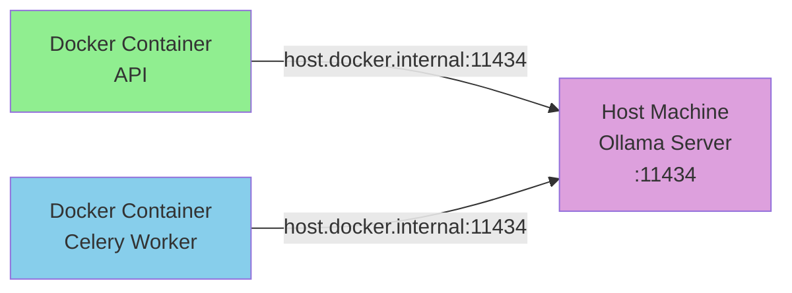

# Using Localhost Ollama with Docker

This guide explains how to use your local Ollama installation with the Dockerized Sanad AEO Auditor.

## Why Use Localhost Ollama?

✅ Use existing Ollama installation and models  
✅ Save Docker resources (no need for ollama container)  
✅ Easier GPU access (if Ollama is using GPU on host)  
✅ Share models across multiple projects  

## Prerequisites

1. **Ollama installed on your host machine**
   ```bash
   # Windows, macOS, or Linux
   # Download from: https://ollama.com/download
   ```

2. **Ollama model downloaded**
   ```bash
   # Pull the model on your host
   ollama pull qwen2.5:7b
   
   # Verify it's downloaded
   ollama list
   ```

3. **Ollama server running**
   ```bash
   # Start Ollama server (usually starts automatically)
   ollama serve
   
   # Verify it's running
   curl http://localhost:11434/api/tags
   ```

## Configuration

The Docker setup is already configured to use localhost Ollama:

### 1. Environment Variables (.env)

```env
# This is already set in .env.example
OLLAMA_HOST=http://host.docker.internal:11434
OLLAMA_MODEL=qwen2.5:7b
```

**Note**: `host.docker.internal` is a special DNS name that resolves to the host machine's IP from within Docker containers. This works on:
- ✅ Docker Desktop for Windows
- ✅ Docker Desktop for macOS
- ⚠️ Linux: May need additional configuration (see below)

### 2. Docker Compose

The `docker-compose.yml` has been updated:
- ❌ No ollama container service
- ✅ API and Celery worker access host Ollama via `host.docker.internal`
- ✅ No ollama volume needed

## How It Works



## Starting the Application

### 1. Ensure Ollama is Running

```bash
# Check if Ollama is accessible
curl http://localhost:11434/api/tags

# Should return JSON with your models
```

### 2. Start Docker Services

```bash
# Using Makefile
make up

# Or using docker-compose
docker-compose up -d
```

### 3. Verify Connection

```bash
# Check API can reach Ollama
docker-compose exec api python -c "
import httpx
try:
    response = httpx.get('http://host.docker.internal:11434/api/tags', timeout=5)
    print('✅ Ollama accessible from container')
    print(response.json())
except Exception as e:
    print(f'❌ Error: {e}')
"
```

## Troubleshooting

### Issue: "Connection refused" from containers

**Symptom**: Docker containers can't connect to localhost Ollama

**Solutions**:

1. **Verify Ollama is running**:
   ```bash
   # On host machine
   curl http://localhost:11434/api/tags
   ```

2. **Check Docker network** (Windows/Mac):
   ```bash
   # Test from container
   docker-compose exec api ping host.docker.internal
   ```

3. **Linux-specific fix**:
   On Linux, `host.docker.internal` doesn't work by default. Add to docker-compose.yml:
   
   ```yaml
   services:
     api:
       extra_hosts:
         - "host.docker.internal:host-gateway"
     
     celery-worker:
       extra_hosts:
         - "host.docker.internal:host-gateway"
   ```

4. **Firewall blocking**:
   Ensure your firewall allows Docker containers to access port 11434:
   
   ```bash
   # Windows (run as admin)
   netsh advfirewall firewall add rule name="Ollama-Docker" dir=in action=allow protocol=TCP localport=11434
   ```

### Issue: Model not found

**Symptom**: "model 'qwen2.5:7b' not found"

**Solution**:
```bash
# Download model on HOST (not in container)
ollama pull qwen2.5:7b

# Verify
ollama list

# Update .env if using different model
OLLAMA_MODEL=your-model-name
```

### Issue: Slow responses

**Symptom**: Ollama requests timeout or are very slow

**Solutions**:
1. **Check resource usage**:
   ```bash
   # Monitor on host
   ollama ps
   ```

2. **Increase timeout** in .env:
   ```env
   OLLAMA_TIMEOUT=300
   ```

3. **Reduce concurrency** if memory-constrained:
   ```bash
   # Stop Ollama
   # Configure to use less memory
   # Restart
   ```

## Switching Models

To use a different model:

1. **Pull model on host**:
   ```bash
   ollama pull llama2:7b
   ```

2. **Update .env**:
   ```env
   OLLAMA_MODEL=llama2:7b
   ```

3. **Restart services**:
   ```bash
   docker-compose restart api celery-worker
   ```

## Optional: Switching Back to Containerized Ollama

If you want to run Ollama in Docker instead:

1. **Update .env**:
   ```env
   OLLAMA_HOST=http://ollama:11434
   ```

2. **Add ollama service** to docker-compose.yml:
   ```yaml
   ollama:
     image: ollama/ollama:latest
     container_name: sanad_ollama
     ports:
       - "11434:11434"
     volumes:
       - ollama_data:/root/.ollama
     networks:
       - sanad_network
   ```

3. **Add volume**:
   ```yaml
   volumes:
     ollama_data:
   ```

4. **Update dependencies**:
   ```yaml
   api:
     depends_on:
       - ollama
   
   celery-worker:
     depends_on:
       - ollama
   ```

5. **Restart and pull model**:
   ```bash
   docker-compose up -d
   docker-compose exec ollama ollama pull qwen2.5:7b
   ```

## Performance Tips

1. **GPU Acceleration**: If your host Ollama uses GPU, containers will benefit automatically
2. **Model Caching**: Models remain cached on host between container restarts
3. **Concurrent Requests**: Ollama handles concurrent requests from multiple containers

## Summary

✅ **No changes needed to application code**  
✅ **Ollama runs on host, containers connect via network**  
✅ **Models managed on host machine**  
✅ **Saves container resources**  

The setup is production-ready and requires no manual intervention once configured!
